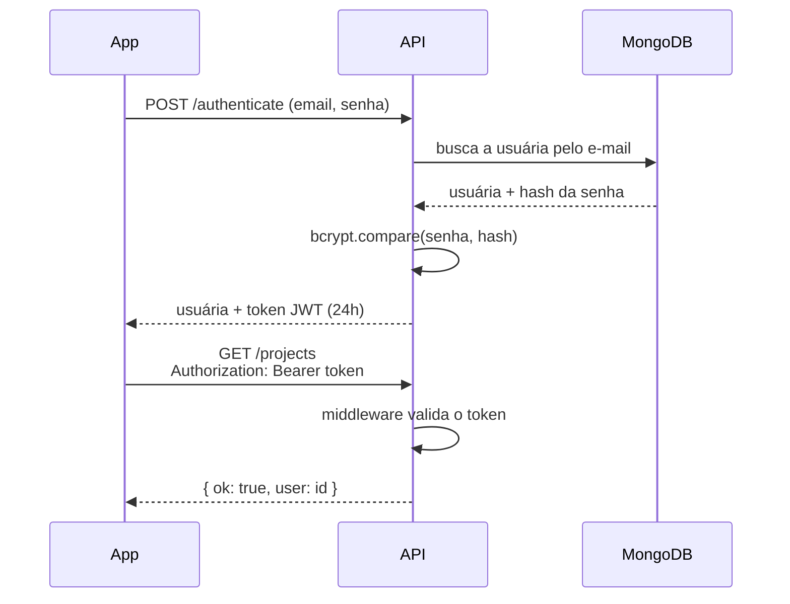

<div align="center">

# API das Ninas

API REST de autenticação da **Ninas**, uma rede social para mulheres que querem empreender em tecnologia.<br>
6º lugar no desafio da MCTIC, na semifinal do [Mega Hack Women](https://www.megahackwomen.com.br/resultado/) (2020).


</div>

## Sobre o projeto

Segundo a ONU Mulheres, só 18% das pessoas formadas em Ciência da Computação no mundo são mulheres. No Brasil, dados da PNAD Contínua (IBGE) mostram que as empreendedoras ganham cerca de 22% menos que os empreendedores. Elas também conseguem empréstimos menores e pagam juros mais altos, mesmo com inadimplência menor.

A Ninas propõe uma rede social para mulheres que querem empreender em tecnologia, com ou sem um projeto pronto. Na rede, elas encontram conteúdos sobre cada fase do empreendedorismo e conversam com outras mulheres para trocar ideias ou formar um time. Depois, podem cadastrar a ideia para investidores. Quando o interesse é recíproco (um *match*), a conversa entre a idealizadora e o investidor é liberada.

Esta API é a base de contas e autenticação da plataforma.

## Funcionalidades

- [x] Cadastro de usuária com senha criptografada (bcrypt, em um hook `pre('save')` do Mongoose)
- [x] Login com token JWT válido por 24 horas
- [x] Rotas protegidas por um middleware que valida o token `Bearer`
- [x] Recuperação de senha: gera um token aleatório, válido por 1 hora, e envia por e-mail (Nodemailer com template Handlebars)
- [x] Redefinição de senha com o token, que só pode ser usado uma vez
- [x] Banco MongoDB rodando em um container Docker

## Endpoints

| Método | Rota | Autenticação | O que faz |
|---|---|---|---|
| `POST` | `/register` | não | Cria uma conta com `nome`, `email` e `password` |
| `POST` | `/authenticate` | não | Valida e-mail e senha e devolve a usuária e um token JWT |
| `POST` | `/forgot_password` | não | Envia por e-mail um token de recuperação |
| `POST` | `/reset_password` | não | Troca a senha usando `email`, `token` e `password` |
| `GET` | `/projects` | `Bearer` | Rota protegida de exemplo: devolve o id da usuária logada |

### Exemplos

```bash
# Cadastro
curl -X POST http://localhost:3000/register \
  -H "Content-Type: application/json" \
  -d '{"nome": "Maria", "email": "maria@email.com", "password": "senha123"}'

# Login: a resposta traz { "user": { ... }, "token": "eyJhbGciOi..." }
curl -X POST http://localhost:3000/authenticate \
  -H "Content-Type: application/json" \
  -d '{"email": "maria@email.com", "password": "senha123"}'

# Rota protegida: a resposta traz { "ok": true, "user": "<id da usuária>" }
curl http://localhost:3000/projects -H "Authorization: Bearer <token>"
```

Respostas de erro: `400` para e-mail já cadastrado ou usuária não encontrada, e `401` para senha errada ou token ausente, mal formatado ou inválido.

Também há uma coleção do Postman com todas as rotas em [`docs/Ninas_API.postman_collection.json`](docs/Ninas_API.postman_collection.json). Ao fazer login por ela, o token é salvo automaticamente e usado na rota protegida.

### Fluxo de autenticação



## Como rodar

Pré-requisitos: Node.js e Docker.

**1. Suba o MongoDB**

```bash
docker run -d --name ninas-mongo -p 27017:27017 mongo:4.4
```

**2. Instale as dependências**

```bash
git clone https://github.com/talialino/Ninas_API.git
cd Ninas_API
npm install
```

**3. Crie os arquivos de configuração**

A pasta `src/config/` está no `.gitignore` para que segredos não vão para o repositório. Crie dois arquivos nela:

`src/config/auth.json`
```json
{ "secret": "troque-por-uma-chave-secreta" }
```

`src/config/mail.json` (dados de um servidor SMTP; para testes, o [Mailtrap](https://mailtrap.io) funciona bem)
```json
{ "host": "sandbox.smtp.mailtrap.io", "port": 2525, "user": "seu-usuario", "pass": "sua-senha" }
```

**4. Inicie a API**

```bash
npm start
```

A API sobe em `http://localhost:3000` e reinicia sozinha a cada alteração (nodemon).

## Estrutura

```
├── index.js                      # servidor Express e conexão com o MongoDB
└── src/
    ├── routes.js                 # rotas públicas e protegidas
    ├── controllers/
    │   ├── authController.js     # cadastro, login e recuperação de senha
    │   └── projectControllers.js # rota protegida de exemplo
    ├── middlewares/auth.js       # validação do token JWT
    ├── models/user.js            # schema da usuária e hash da senha
    ├── modules/mailes.js         # envio de e-mail (Nodemailer + Handlebars)
    └── resources/mail/           # template do e-mail de recuperação
```

## Próximos passos

- Levar a URL do banco e os segredos para variáveis de ambiente (`.env`)
- Criar os recursos da rede social: perfis, projetos e o *match* com investidores

## Equipe

1. **[Bianca Amaral](https://www.linkedin.com/in/bia-amaral/)**
2. **[Camila Fersan](https://www.linkedin.com/in/camila-fernanda-santos/)**
3. **[Gabriela Cavalcante](https://www.linkedin.com/in/gabrielaacavalcante/)**
4. **[Maryana Morato](https://www.linkedin.com/in/maryanamorato/)**
5. **[Talia Lino](https://www.linkedin.com/in/talia-lino-de-oliveira/)**: desenvolvimento da API

## Licença

[MIT](LICENSE)
